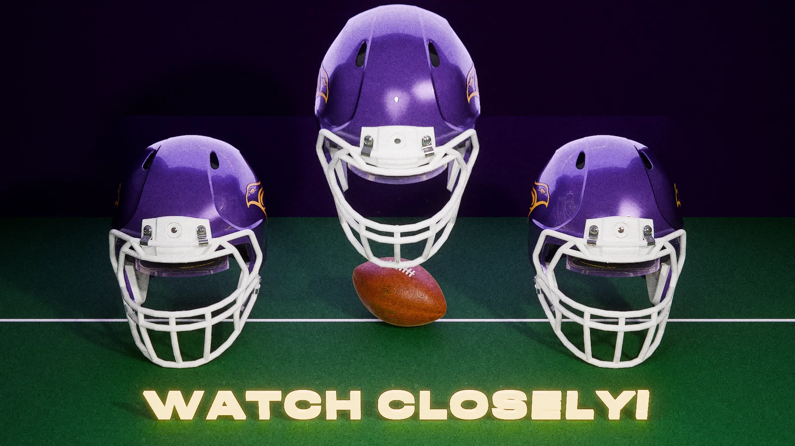

# Golden Hawks Helmet Shuffle

A Blender add-on that builds the helmet shell game for Laurier Athletics' football videoboard: three helmets, one football, and a winner you choose before you render.

[](https://github.com/solufelo/golden-hawks-helmet-shuffle/actions/workflows/blender-ci.yml)

[](https://solufelo.github.io/golden-hawks-helmet-shuffle/)

*The delivered clip, variant 3: the right helmet wins. Watch it on the [project page](https://solufelo.github.io/golden-hawks-helmet-shuffle/).*

## Delivered

Made for the Senior Day game against Carleton on October 17, 2026, at Knight-Newbrough Field in Waterloo.

- **Variants:** V1 left wins, V2 center wins, V3 right wins
- **Masters:** Apple ProRes 422 HQ
- **Previews:** H.264 with game-show sound
- **Format:** 1920 × 1080, 30 fps, 16 seconds

## What it does

- Sets up three helmets and one football. You pick the winning slot: left, center or right.
- An intro reveal lifts a helmet to show where the ball starts.
- The helmets swap places, with short pauses between moves and a suspense hold before the reveal.
- A camera dolly pushes in for the swaps and pulls back for the reveal.
- Banners cue the crowd (WATCH CLOSELY!, WHERE IS IT?), and the numerals 1, 2, 3 let fans call their pick.
- Title and banner text tilt to face the camera, so their lines don't foreshorten.

## Speed

The add-on times its own bakes. The 305-frame benchmark scene (30 fps) bakes in under 100 ms; full variants with longer timelines take 118–164 ms.

## Exports

- **Cue sheet:** JSON and CSV with the frame and timecode of every swap, the suspense hold and the reveal, for After Effects and sound.
- **Game-engine tracks:** JSON per frame: unit quaternions [w, x, y, z], velocity vectors and Y-up positions.
- **Trajectory arcs:** 3D curves of each helmet's path, for checking clearances between swaps.

## Install

Needs Blender 4.0 or newer.

1. Download [`releases/laurier_golden_hawks_shuffle_v3.5.2.zip`](releases/laurier_golden_hawks_shuffle_v3.5.2.zip). Keep it zipped.
2. In Blender, open **Edit › Preferences › Add-ons**.
3. Open the menu at the top right, choose **Install from Disk** and pick the zip. On Blender 4.0 and 4.1, use the **Install** button.
4. Tick **Golden Hawks Helmet Shuffle** if it isn't already on.
5. In the 3D Viewport, press **N** and open the **Golden Hawks** tab.

## Run it headless

From the repo folder, with Blender on your PATH.

**Test suite.** 12 checks; all pass on a fresh Blender 5.2.

```
blender -b --python scripts/test_addon.py
```

**Batch bake.** A center-wins shuffle that writes the game-engine tracks and a timing report to the current folder.

```
blender -b --python scripts/pipeline_batch_runner.py -- --swaps 4 --outcome SLOT_2
```

`--swaps` sets the number of swaps (3 to 30). `--outcome` picks the winner: `SLOT_1` left, `SLOT_2` center, `SLOT_3` right, or `RANDOM`.

## Repository

- `blender_addon/`: the add-on and its manifest
- `golden_hawks_shuffle.py`: the same add-on as a single file
- `scripts/`: the test suite and the batch runner
- `releases/`: the installable zip
- `index.html` and `assets/web/`: the project page
- `docs/`: design notes and the changelog

## Credits

Built by Solomon Olufelo for Laurier Athletics football. More in the [Laurier Game Day case study](https://captainsolo.ca/work/laurier-gameday), at [captainsolo.ca](https://captainsolo.ca), and in the [Light Years Engine](https://solufelo.github.io/light-years-engine/).

## License

See [LICENSE](LICENSE).
